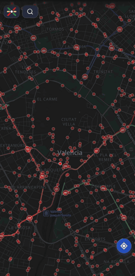

<table>
  <tr>
    <td valign="middle" width="55%">
      <h1> Xarxa</h1>
      

        <i>EN</i> · Where every Valencia metro train is, right now, and when the next one reaches you. Honest by design: trains are drawn from live predictions and fade when their position becomes a guess. 
        <i>ES</i> · Dónde está cada tren del metro de Valencia, ahora mismo, y cuándo llega el próximo hasta ti. Honesto por diseño: los trenes se dibujan con predicciones en directo y se difuminan cuando su posición pasa a ser una suposición. 
        <i>VA</i> · On està cada tren del metro de València, ara mateix, i quan t'arriba el pròxim. Honest per disseny: els trens es dibuixen amb prediccions en directe i es difuminen quan la posició passa a ser una suposició.
      

      

        
      

      

        
      

    </td>
    <td valign="middle" align="center" width="45%">
      
    </td>
  </tr>
</table>

## What you can do

- **Watch trains move** live on the real track
- **Nearest station in one tap**, with walk time (location never leaves your phone)
- **Live countdowns** for any station
- **Follow one line** or search any stop
- **Light, dark or auto**, bigger text
- **Departures board** for a spare screen: [?mode=dashboard](https://xarxa.net/?mode=dashboard)
- **3 languages**: English, Español, Valencià
- **Poor connection OK**: the map is stored with the app

---

## Two ways to use it

| | |
|---|---|
| **On the web** | Go to **[xarxa.net](https://xarxa.net)**. Nothing to install: it works in any phone or computer browser, in English, Spanish and Valencian. |
| **On Android** | **[Download the app](https://github.com/JieGH/vibe_VLCmetroMap/releases/latest/download/Xarxa-android.apk)** (a free APK file). The app is not on Google Play yet, so Android will ask you to allow the install. Steps below. |
| **On iPhone** | There is no iPhone app yet. Open [xarxa.net](https://xarxa.net) in Safari, tap Share, then **Add to Home Screen**: it then opens like an app. |

## Installing the Android app

1. On your phone, open the **[download link](https://github.com/JieGH/vibe_VLCmetroMap/releases/latest/download/Xarxa-android.apk)**.
2. When it has finished downloading, open the file.
3. If Android asks, allow installing from your browser. You only do this once.

It needs Android 8 or newer. It follows your phone's light or dark theme, and asks before using your location. Prefer automatic updates? [Obtainium](https://obtainium.imranr.dev) can install and update it straight from this page: add `https://github.com/JieGH/vibe_VLCmetroMap` and set the APK filter to `.*android\.apk`.

What changed in each version: **[Releases](https://github.com/JieGH/vibe_VLCmetroMap/releases)**.

## How the trains are placed

Metrovalencia publishes when a train is due at a station, but not where it is. Xarxa works that out: it takes the live predictions and walks each train backwards along the real rail geometry, to the point those predictions imply. Against live data this is about 130 m off on average. The details are in [DEVELOPERS.md](DEVELOPERS.md).

## Questions

- **Is it official?** No. It is an independent project, not affiliated with or endorsed by [FGV](https://www.fgv.es), which owns the Metrovalencia name, brand and data.
- **What about my privacy?** No accounts, no analytics, no tracking. Your location is only used on your device to find the nearest station. See the [privacy policy](docs/android/privacy-policy.md).
- **Something is wrong or missing?** [Open an issue](https://github.com/JieGH/vibe_VLCmetroMap/issues), or write to the author from the menu inside the app.
- **Where is the old address?** The previous site (`tangerine-panda-1aeea5.netlify.app`) now just points visitors to xarxa.net.

## For developers

Building, running, hosting, data sources, architecture and releasing: **[DEVELOPERS.md](DEVELOPERS.md)**.

## Credits and license

Made in Valencia by Jie Lei. Code: source-available, all rights reserved, see [LICENSE](LICENSE); reuse, redistribution or modification needs written permission. Thanks to FGV for the live data, to OpenStreetMap's contributors for the track geometry, and to Protomaps for the offline map. FGV's data, OpenStreetMap's and the Metrovalencia brand carry their own terms.
