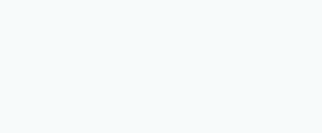

  

<h1 align="center">Xarxa</h1>

  <strong>Where every Valencia metro train is, right now, and when the next one reaches you.</strong>

  
  &nbsp;
  

  

---

## Two ways to use it

| | |
|---|---|
| **On the web** | Go to **[xarxa.net](https://xarxa.net)**. Nothing to install: it works in any phone or computer browser, in English, Spanish and Valencian. |
| **On Android** | **[Download the app](https://github.com/JieGH/vibe_VLCmetroMap/releases/latest/download/Xarxa-android.apk)** (a free APK file). The app is not on Google Play yet, so Android will ask you to allow the install. Steps below. |
| **On iPhone** | There is no iPhone app yet. Open [xarxa.net](https://xarxa.net) in Safari, tap Share, then **Add to Home Screen**: it then opens like an app. |

## What you can do

- **See the trains move.** Every train is drawn on the real track and glides to its next position as new predictions arrive.
- **Find your nearest station in one tap.** The blue location button centres the map on you, shows how far the walk is, and opens that station's departures. Your location stays on your phone and is never sent anywhere.
- **Check any station.** Tap it for the next trains in each direction, with live countdowns.
- **Follow one line.** Pick a line and the map frames the whole line, showing the main stations first and the rest as you zoom in.
- **Search** for a station or line, or use the shortcuts to the busiest stops.
- **Light, dark or automatic**, and bigger text if you need it.
- **A departures board** for a tablet or spare screen: open [xarxa.net/?mode=dashboard](https://xarxa.net/?mode=dashboard).
- **Works with a poor connection.** The map is stored with the app.

Trains are honest about doubt: a train fades as its exact position becomes a guess, and nothing is drawn where the data cannot place it.

## Installing the Android app

1. On your phone, open the **[download link](https://github.com/JieGH/vibe_VLCmetroMap/releases/latest/download/Xarxa-android.apk)**.
2. When it has finished downloading, open the file.
3. If Android asks, allow installing from your browser. You only do this once.

It needs Android 8 or newer. It follows your phone's light or dark theme, and asks before using your location. Prefer automatic updates? [Obtainium](https://obtainium.imranr.dev) can install and update it straight from this page: add `https://github.com/JieGH/vibe_VLCmetroMap` and set the APK filter to `.*android\.apk`.

What changed in each version: **[Releases](https://github.com/JieGH/vibe_VLCmetroMap/releases)**.

## How the trains are placed

Metrovalencia publishes when a train is due at a station, but not where it is. Xarxa works that out: it takes the live predictions and walks each train backwards along the real rail geometry, to the point those predictions imply. Against live data this is about 130 m off on average. The details are in [DEVELOPERS.md](DEVELOPERS.md).

## Questions

- **Is it official?** No. It is an independent project, not affiliated with or endorsed by [FGV](https://www.fgv.es), which owns the Metrovalencia name, brand and data.
- **What about my privacy?** No accounts, no analytics, no tracking. Your location is only used on your device to find the nearest station. See the [privacy policy](docs/android/privacy-policy.md).
- **Something is wrong or missing?** [Open an issue](https://github.com/JieGH/vibe_VLCmetroMap/issues), or write to the author from the menu inside the app.
- **Where is the old address?** The previous site (`tangerine-panda-1aeea5.netlify.app`) now just points visitors to xarxa.net.

## For developers

Building, running, hosting, data sources, architecture and releasing: **[DEVELOPERS.md](DEVELOPERS.md)**.

## Credits and license

Made in Valencia by Jie Lei. Code: [Apache 2.0](LICENSE). Thanks to FGV for the live data, to OpenStreetMap's contributors for the track geometry, and to Protomaps for the offline map. FGV's data, OpenStreetMap's and the Metrovalencia brand carry their own terms.
